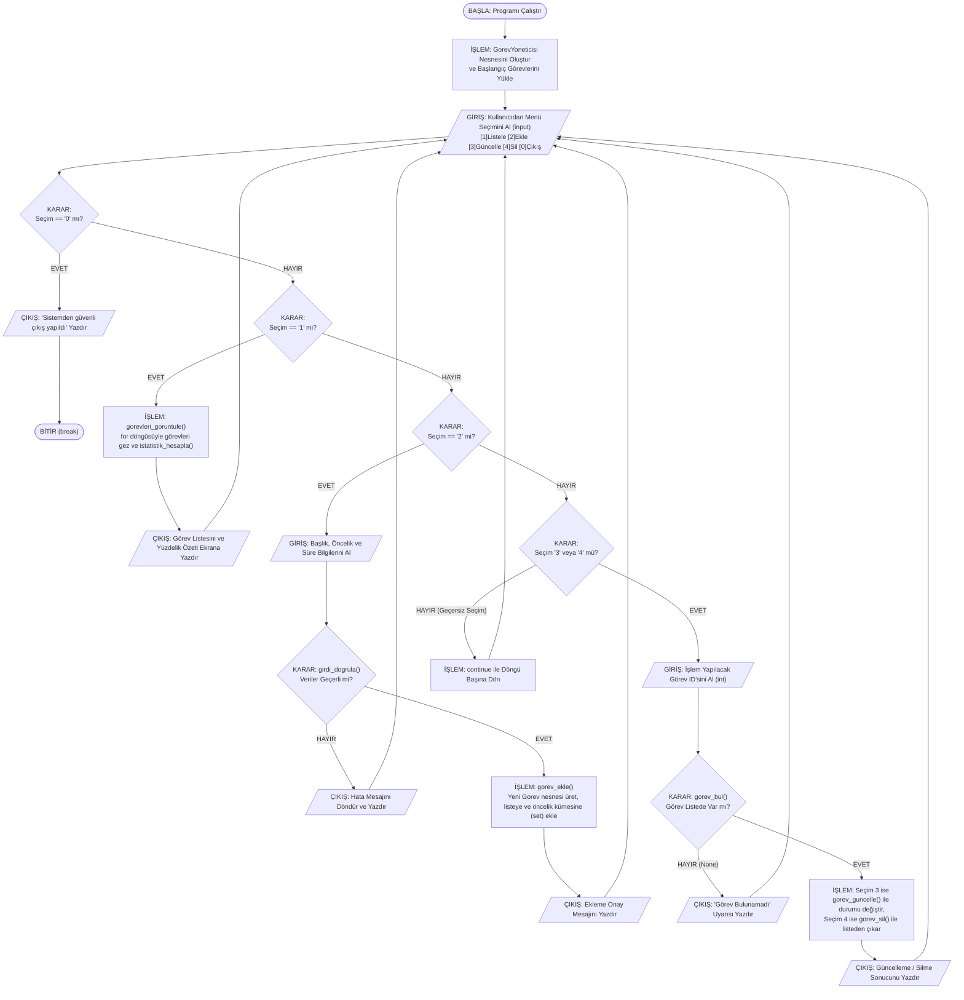

# TALOS Otonom Araç Görev Yönetim Sistemi (To-Do List Mini Projesi)

**Geliştirici:** Ali İhsan Dağaşan  
**Kapsam:** TALOSLU OLMAK — 1. Hafta (Python Giriş) Proje Görevi  
**Uygulama Boyutu:** 99 Satır (50–100 satır standardına tam uyumlu, modüler ve yorum satırlı)  

---

## 1. Proje Tanıtımı
Bu proje, Python 1. Hafta temelleriyle geliştirilmiş nesne yönelimli bir **Görev Yönetim (To-Do List) Uygulamasıdır**.

### Teknik Gereksinim Karşılama Özeti
- **En az 2 Sınıf (`class`):** `Gorev` ve `GorevYoneticisi` sınıfları (`__init__` kurucu metotları, nesne nitelikleri ve sınıf metotları ile).
- **En az 4 Fonksiyon (`def`):** 5 adet bağımsız modüler fonksiyon (`girdi_dogrula`, `gorev_ekle`, `gorev_guncelle`, `gorev_sil`, `gorevleri_goruntule`).
- **Veri Tipleri ve Yapıları:** `int`, `float`, `str`, `bool`, `type()`, `input()`, `list`, `tuple`, `dict`, `set`.
- **Kontrol Akışı:** Aritmetik/Karşılaştırma/Mantıksal operatörler, `if-elif-else`, iç içe koşullar, `for` ve `while` döngüleri (`break` ve `continue`).

---

## 2. Zorunlu Akış Şeması (Flowchart: Giriş → İşlem → Çıkış)

Uygulama **Giriş → İşlem → Çıkış** mantığında ilerlemekte olup tüm adımlar birbirine mantıklı karar düğümleriyle bağlıdır:

### 2.1. Görsel Akış Şeması (Mermaid Flowchart)



### 2.2. Metin Tabanlı (ASCII) Akış Şeması

```text
                       ([ BAŞLA: Program Başlatılır ])
                                      │
                                      ▼
          [ İŞLEM: GorevYoneticisi Nesnesi ve Örnek Görevler Oluşturulur ]
                                      │
       ┌──────────────────────────────┴──────────────────────────────┐
       ▼                                                             │
[/ GİRİŞ: Kullanıcıdan Menü Seçimi Alınır (1:Listele, 2:Ekle, 3:Güncelle, 4:Sil, 0:Çıkış) /]
       │                                                             │
       ▼                                                             │
  ◆ KARAR: Seçim Hangisi? ◆                                          │
   ├─► [0: Çıkış] ──► [/ ÇIKIŞ: Güvenli Çıkış Mesajı /] ──► ([ BİTİR (break) ])
   │                                                                 │
   ├─► [1: Listele] ──► [ İŞLEM: İstatistik Hesapla & Listeyi Gez ] ─┤
   │                    [/ ÇIKIŞ: Görevleri ve Özeti Yazdır /] ──────┤
   │                                                                 │
   ├─► [2: Ekle] ──► [/ GİRİŞ: Başlık, Öncelik, Süre Al /]           │
   │                 ◆ KARAR: girdi_dogrula() Geçerli mi? ◆          │
   │                  ├─ EVET ─► [ İŞLEM: Gorev Nesnesi Üret & Ekle ]┤
   │                  └─ HAYIR ► [/ ÇIKIŞ: Hata Mesajı Göster /] ────┤
   │                                                                 │
   ├─► [3/4: Güncelle/Sil] ──► [/ GİRİŞ: Görev ID Al /]              │
   │                           ◆ KARAR: gorev_bul() Var mı? ◆        │
   │                            ├─ EVET ─► [ İŞLEM: Güncelle / Sil ] ┤
   │                            └─ HAYIR ► [/ ÇIKIŞ: Uyarı Göster /] ┤
   │                                                                 │
   └─► [Diğer / Geçersiz] ──► [ İŞLEM: continue ile Turu Atla ] ─────┘
```

---

## 3. Kodun Mantığını Açıklama Raporu

### 3.1. Sınıflar Neden Böyle Tasarlandı?
Projede sorumlulukların ayrılması (**Single Responsibility Principle**) amacıyla iki ayrı sınıf tasarlanmıştır:
1. **`Gorev` Sınıfı (Veri Modeli):** Tek bir görevin ne olduğunu tanımlar. İçerisinde görevin kimliği (`id: int`), açıklaması (`baslik: str`), önceliği (`oncelik: str`), tahmini süresi (`tahmini_saat: float`) ve bitip bitmediği (`tamamlandi: bool`) niteliklerini (attributes) barındırır. `durum_degistir()` ve `bilgi_satiri()` metotlarıyla kendi durumunu yönetir.
2. **`GorevYoneticisi` Sınıfı (Koleksiyon ve İş Mantığı):** Birden fazla `Gorev` nesnesini bir arada tutan yöneticidir. Görevleri sıralı bir listede (`self.gorevler: list`), kullanılan öncelik düzeylerini ise tekrarsız bir kümede (`self.oncelik_kumesi: set`) saklar. `gorev_bul()` metoduyla arama yapar, `istatistik_hesapla()` metoduyla toplam süre ve tamamlanma yüzdesini hesaplayıp sözlük (`dict`) olarak döndürür.

### 3.2. Fonksiyonlar Hangi Amaçla Yazıldı?
Kod tekrarını önlemek ve her işlemi bağımsız bir modül haline getirmek için **5 ayrı fonksiyon (`def`)** yazılmıştır:
1. **`girdi_dogrula(baslik, oncelik, saat_metni)`:** Kullanıcıdan gelen ham verilerin boş olup olmadığını, önceliğin `GECERLI_ONCELIKLER` tuple'ı içinde yer alıp almadığını ve sürenin `0–100` saat arasında geçerli bir sayı olup olmadığını denetler.
2. **`gorev_ekle(yonetici, ...)`:** Önce doğrulama fonksiyonunu çağırır; veri geçerliyse yeni bir `Gorev` nesnesi oluşturup yöneticinin listesine ve öncelik kümesine ekler.
3. **`gorev_guncelle(yonetici, gorev_id, yeni_baslik)`:** ID üzerinden görevi bulur, varsa durumunu (`BEKLİYOR` ↔ `TAMAMLANDI`) ve başlığını günceller.
4. **`gorev_sil(yonetici, gorev_id)`:** ID ile aranan görevi bulup `.remove()` metoduyla listeden güvenli biçimde siler.
5. **`gorevleri_goruntule(yonetici)`:** Tüm görevleri `for` döngüsüyle ekrana basar ve sözlük (`dict`) formatındaki istatistik özetini görüntüler.

### 3.3. Koşullar Nasıl Çalışıyor?
- **Ana Menü Dallanması (`if / elif / else`):** Kullanıcının girdiği seçime (`0, 1, 2, 3, 4`) göre ilgili fonksiyonu tetikler.
- **Mantıksal ve Karşılaştırma Koşulları:** `girdi_dogrula` fonksiyonunda `if baslik.strip() == "" or oncelik not in GECERLI_ONCELIKLER:` koşulu ile `or`, `==` ve `not in` operatörleri birlikte çalıştırılır; ardından süre için `0 < saat <= 100` aralık kontrolü yapılır.
- **Nesne Varlık Kontrolü:** Güncelleme ve silme işlemlerinde `if hedef is None:` kontrolü yapılarak olmayan bir ID girildiğinde programın çökmesi engellenir.

### 3.4. Programın Genel İşleyişi Nedir?
Program başlatıldığında `GorevYoneticisi` sınıfından `sistem` adında bir nesne türetilir ve test kolaylığı için 2 adet örnek görev otomatik yüklenir. Ardından `while True:` döngüsü ile kullanıcıya etkileşimli menü sunulur. Kullanıcı işlem seçtikçe ilgili fonksiyonlar nesne üzerindeki listeyi günceller ve sonuçları ekrana döndürür.

### 3.5. Kullanıcı Programı Açınca Hangi Adımları Takip Eder?
1. Terminalde `python gorev_yoneticisi.py` komutunu çalıştırır.
2. Ekrana gelen `[1]Listele [2]Ekle [3]Güncelle [4]Sil [0]Çıkış` menüsünden yapmak istediği işlemin numarasını girer.
3. **`1` seçerse:** Mevcut görevleri ve tamamlanma yüzdesini görür.
4. **`2` seçerse:** Sırasıyla görev başlığını, önceliği (`Düşük/Normal/Yüksek`) ve tahmini saati girerek yeni görev ekler.
5. **`3` veya `4` seçerse:** İşlem yapmak istediği görevin ID numarasını girerek görevi tamamlandı olarak işaretler veya siler.
6. **`0` seçerse:** `break` komutuyla döngü sonlanır ve programdan güvenli çıkış yapılır.

---

## 4. Nasıl Çalıştırılır?

```bash
python gorev_yoneticisi.py
```
